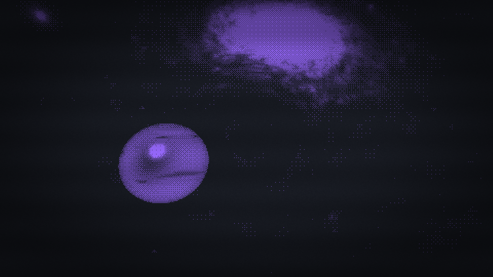
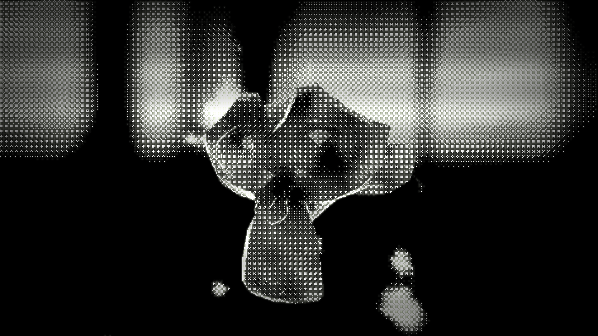
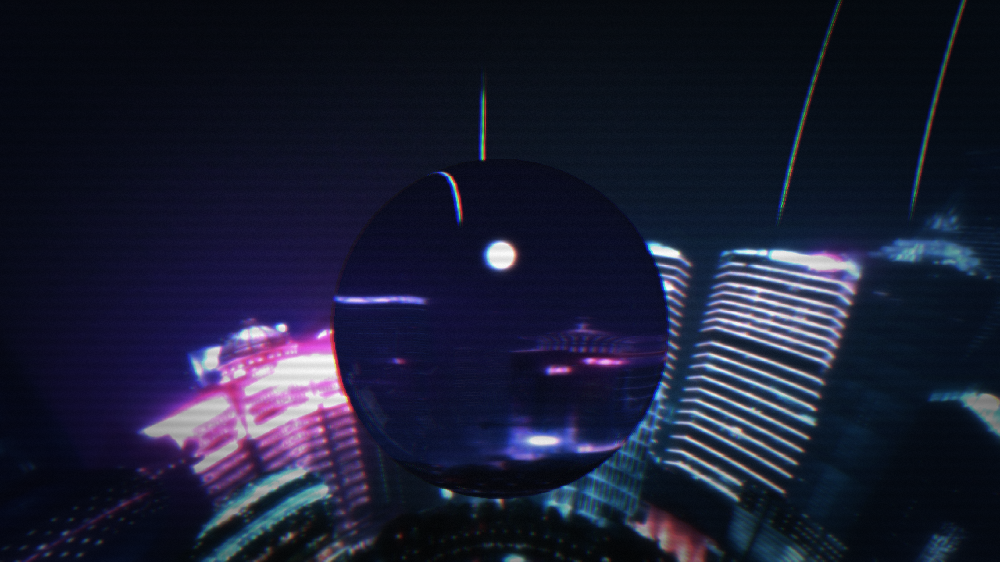

# SHADER VIEWER // 3D SHADERS & PHYSICS LAB

```text
================================================================================
  [LABORATORY] Real-Time GLSL Shaders, Havok Physics & Post-Processing Pipeline
  [ENGINE]     Babylon.js 9.x + Havok WASM + React 19 + TypeScript + Vite
  [INTERFACE]  Industrial Brutalist UI System / Tweakpane v4 / HUD Telemetry
================================================================================
```

O **Shader Viewer** e um laboratorio interativo em tempo real para experimentacao grafica de shaders GLSL, simulacao de corpos rigidos com Havok Physics e pipelines avancados de pos-processamento, construido sobre a arquitetura do Babylon.js.

Projetado sob a filosofia de ferramentas de desenvolvimento industrial, a aplicacao desacopla estritamente o ciclo de vida reativo da interface (React 19) do loop imperativo de renderizacao gráfica (60+ FPS no WebGL). Alem da operacao web interativa, inclui uma suite de compilacao headless otimizada para o Lively Wallpaper.

---

## // REGISTRO VISUAL (4K SCREENSHOTS)

> Capturas brutas em resolucao 3840x2160 geradas atraves do pipeline de supersampling sincronizado no backbuffer (`F9` / Screenshot 4K).


* Figura 1.0: Dithering Duotone Post-Process com Galaxy Skybox e uma esfera.
<br />


* Figura 2.0: Dithering Duotone Post-Process com Cosmic Skybox e o Suzanne.
<br />


* Figura 3.0: Scan-lines, Chrome aberration e dessaturação com Xangai skybox e uma esfera de vidro.

---

## // ARQUITETURA E STACK TECNOLOGICA

### A) Núcleo Gráfico e Físico
* **Babylon.js 9.x (`@babylonjs/core`, `@babylonjs/loaders`, `@babylonjs/materials`)**:
  - Motor de renderizacao WebGL com controle direto de `ShaderMaterial`, `PostProcess` e Render Target Textures (RTT).
  - Pipeline de profundidade e normais desacoplado (`DepthNormalManager`) para iluminacao e efeitos de superficie.
* **Havok Physics (`@babylonjs/havok`)**:
  - Motor de fisica de alta performance executado nativamente via WebAssembly (`~2.1 MB WASM`).
  - Dinamica de corpos rigidos interativos (`PhysicsAggregate`) e limites espaciais calculados dinamicamente via frustum da camera.
* **TypeScript 5.x / 6.x**:
  - Tipagem estrita de uniforms, presets de cena, vetores, matrizes e barramento de eventos pub/sub (`EventBus`).

### B) Interface e Telemetria
* **React 19 (`react`, `react-dom`)**:
  - Camada estrutural externa de baixo ciclo de re-renderizacao.
  - Controle de atalhos globais, cursor customizado SVG, barras de carregamento e montagem de containers DOM.
* **Tweakpane v4 (`tweakpane`, `@tweakpane/core`)**:
  - Manipulacao imperativa de uniforms em tempo real sem intermediacao de state do React.
  - Estilizacao customizada com identidade Industrial Brutalist (`#B84A4A` oxidado, cantos retos `0px`, fonte `JetBrains Mono`).
* **HUD Telemetry (`PerformanceBar`)**:
  - Monitoramento continuo de FPS, frametime (ms), draw calls, contagem de triangulos, active meshes e memoria de particulas/fisica via `SceneInstrumentation`.

### C) Build & Pipeline
* **Vite 8.x**:
  - Compilacao relampago, HMR instantaneo e resolucao universal de caminhos relativos (`base: './'`).
* **Orquestrador Headless (`scripts/build-lively.mjs`)**:
  - Pipeline especializado para Lively Wallpaper: executa Dead-Code Elimination de UI/Tweakpane em tempo de compilacao (`__LIVELY_BUILD__`), analisa dependencias estaticas do preset e realiza pruning cirurgico de assets de ~80 MB para ~10 MB.

---

## // RECURSOS DO SISTEMA

* **Shaders e Materiais Customizados**:
  - GLSL custom shaders, deformacoes de vertice (ondas, flickering) e materiais estilizados (Toon Shading, Holograma, Dithering Duotone, Pixelation).
* **Simulacao Climatica Dinamica**:
  - Sistemas de particulas GPU integrados para neve, chuva torrencial, cinzas vulcanicas e tempestade de areia.
* **Interacoes Fisicas em Tempo Real**:
  - Ferramenta *Finger*: Arraste, arremesso e colisao direta de corpos rigidos.
  - Ferramenta *Magnet*: Campo de atracao (botao esquerdo) e repulsao em alta forca (botao direito) via cursor vetorial reativo.
* **Captura de Tela 4K sem Distorcao**:
  - Redimensionamento instantaneo do backbuffer para `3840x2160`, reconfiguracao de RTTs, ocultacao de helpers graficos e exportacao direta em PNG sem perdas.

---

## // MAPA DE ATALHOS DO TECLADO

```text
+----------+-----------------------------------------------------------+
| ATALHO   | ACAO OPERACIONAL                                          |
+----------+-----------------------------------------------------------+
| [ H ]    | Alternar visibilidade da UI (Interface Tweakpane / HUD)   |
| [ F3 ]   | Alternar telemetria de performance em tempo real (HUD)    |
| [ F9 ]   | Disparar captura de tela em resolucao 4K (3840x2160 PNG)  |
| [ MOUSE ]| Borda/Arrasto (Finger) // Atracao (LMB) & Repulsao (RMB)   |
+----------+-----------------------------------------------------------+
```

---

## // INSTALACAO E EXECUCAO LOCAL

### Pre-requisitos
* Node.js 20.x ou superior
* Gerenciador de pacotes `npm` ou `pnpm`

### Comandos de Inicializacao

```bash
# 1. Clonar o repositorio
git clone https://github.com/SEU_USUARIO/Shader_Viewer.git
cd Shader_Viewer

# 2. Instalar dependencias
npm install

# 3. Executar o servidor de desenvolvimento
npm run dev

# 4. Validar linter e estilizacao de tipos
npm run lint

# 5. Compilar versao de producao (Web)
npm run build
```

A aplicacao web estara disponivel em `http://localhost:5173`.

---

## // BUILD HEADLESS PARA LIVELY WALLPAPER

O projeto possui suporte nativo para ser empacotado como papel de parede interativo leve para o **Lively Wallpaper**:

```bash
# Compilar pacote otimizado para o preset ativo
npm run build:lively

# Compilar pacote para um preset especifico (ex: dithering_planet, car_rain)
node scripts/build-lively.mjs --preset=dithering_planet
```

O script ira gerar o diretorio `dist-lively/` com o manifesto `LivelyInfo.json` e apenas os modelos/texturas estritamente necessarios para aquele preset.

---

## // ESTRUTURA DO PROJETO

```text
Shader_Viewer/
|-- public/                  # Assets estaticos (.glb, skyboxes .env, texturas)
|-- scripts/                 # Scripts de build especializada (Lively Wallpaper)
|-- src/
|   |-- babylon/
|   |   |-- controllers/     # Controladores mestres de cena, shaders e modelos
|   |   |-- core/            # EventBus desacoplado e adaptadores de ciclo
|   |   |-- entities/        # Entidades e agregadores de fisica
|   |   |-- interactions/    # Efeitos de cursor (Finger, Magnet, Repulsor)
|   |   `-- managers/        # Gerenciadores de camera, luz, clima, RTT e UI
|   |-- components/          # Componentes React (Canvas3D, CustomCursor, HUD)
|   |-- configs/             # Presets de cena, modelos, skyboxes e fisicas
|   |-- styles/              # Tema Industrial Brutalist do Tweakpane v4
|   |-- App.tsx              # Ponto de entrada React da interface
|   `-- main.tsx             # Bootstrap da aplicacao
|-- index.html               # Shell HTML brutalista com metadags SEO/OG
|-- vite.config.ts           # Configuracao do bundler com base relativa './'
`-- package.json             # Manifest de dependencias e scripts de automacao
```
